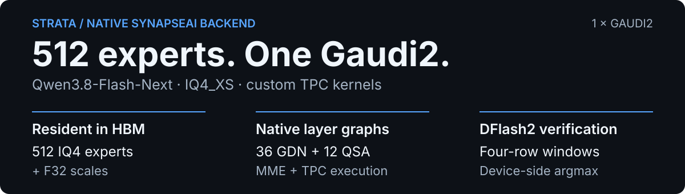
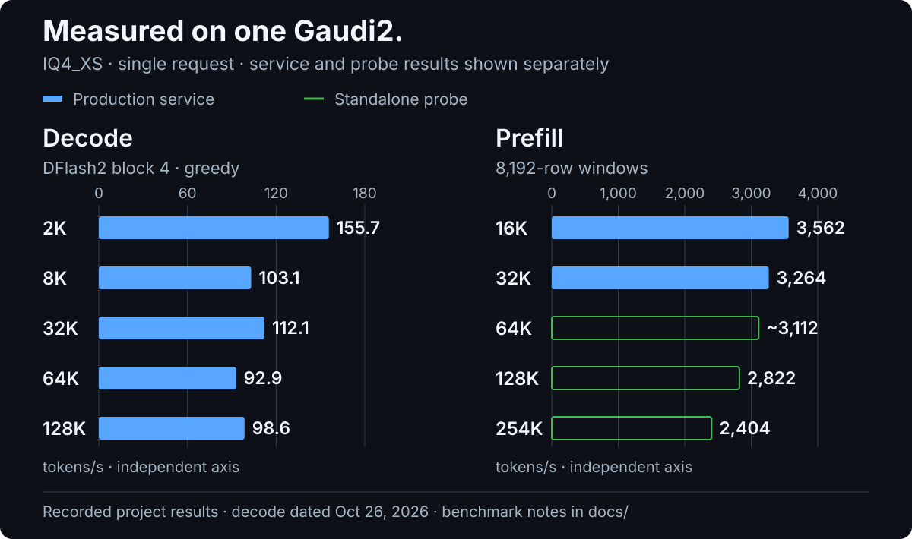

<div align="center">

# Strata on a Single Gaudi2

**Native Qwen3.8-Flash-Next inference: 512 MoE experts on one Intel Gaudi2.**

[](#tested-environment)
[](#how-it-works)
[](LICENSE)

[Performance](#performance) · [Docker quick start](#docker-quick-start) · [Build from source](#build-from-source) · [API](#api) · [Limitations](#limitations)

</div>

<p align="center">
  
</p>

This repository adds a **native Gaudi2 backend** to [Strata](docs/STRATA_UPSTREAM_README.md). Each model layer becomes a SynapseAI graph executing on Gaudi2's matrix engines (MME) and tensor processor cores (TPC). The backend includes more than 100 custom TPC kernel sources, a DFlash2 decode path, and OpenAI- and Anthropic-compatible serving.

The supported model is **Qwen3.8-Flash-Next**, a 48-layer, 512-expert MoE with a configured **262,144-token context limit**. The existing CUDA, HIP, SYCL, and Metal code remains upstream context; the Gaudi2 implementation lives in [`hpu/`](hpu/).

## Performance

The existing project measurements use **one Gaudi2 HL-225**, **IQ4_XS GGUF**, and **one request at a time**. Decode and prefill use different protocols, described below.

<p align="center">
  
</p>

### Decode — production service

DFlash2 speculative decoding, **block size 4**, **greedy sampling**, measured with [llm_speedtest](https://github.com/gengchaogit/llm_speedtest) on **October 26, 2026**.

| Context label | 2K | 8K | 32K | 64K | 128K |
|:---|---:|---:|---:|---:|---:|
| Decode (tokens/s) | **155.7** | 103.1 | 112.1 | 92.9 | 98.6 |

The reported mean accepted-token count is approximately **2.9 tokens per verify round**. A later optimization, enabled from October 27, reduced a four-row verify window from **19.26 to 18.63 ms** at 2K context, using a trimmed mean over 119 windows. That timing is separate from the October 26 throughput table. Without DFlash, a 2K standalone probe reports approximately **12.8 ms per decoded token**.

### Prefill — service and standalone probes

All rows use an **8,192-row prefill window**. The 16K and 32K results come from the production service; 64K and above come from a single-process probe using sparse attention at long contexts.

| Prompt-length label | 16K | 32K | 64K | 128K | 254K |
|:---|---:|---:|---:|---:|---:|
| Prefill (tokens/s) | **3,562** | 3,264 | ~3,112 | 2,822 | 2,404 |
| Measurement | Service | Service | Probe | Probe | Probe |

These are preserved project measurements, not new runs. The context labels retain the original report's K notation. A 254K prefill probe does not establish full-context production-service validation.

→ [Benchmark notes and conditions](docs/GAUDI2_BENCHMARKS.md) · [Editable data](docs/benchmarks/gaudi2-performance.csv)

## Tested environment

| Component | Recorded configuration |
|:---|:---|
| Accelerator | **1× Intel Gaudi2 HL-225**, 98,304 MiB HBM |
| Driver / SynapseAI | **habanalabs 1.24.1** |
| TPC compiler | `tpc-clang 2.7.33` |
| OS / toolchain | Ubuntu 24.04.4, g++ 13.3, CMake 4.4, Python 3.12 |
| CPU / host RAM | Xeon E5-2696 v3, 251 GB RAM |
| Host-memory planning | PLE tables occupy approximately 28.8 GB; **128 GB+ RAM recommended** |

## Model files

Prepare these assets before starting the service:

| Asset | Source and configuration |
|:---|:---|
| Target | [orcarouter/Qwen3.8-Flash-Next-Uncensored-GGUF](https://huggingface.co/orcarouter/Qwen3.8-Flash-Next-Uncensored-GGUF), **IQ4_XS**, all 3 shards; point the config at shard 1 |
| DFlash2 draft | Download the full [incoai/Qwen3.8-Flash-Next-DFlash2](https://huggingface.co/incoai/Qwen3.8-Flash-Next-DFlash2) directory; native runs use `STRATA_HPU_DFLASH` |
| Tokenizer | The model tokenizer generated by Strata setup, `pack/full/tokenizer`; see [setup instructions](docs/AI_SETUP.md), then set the config's `tokenizer` field |

All 512 experts stay in HBM as IQ4 codes plus F32 scales, approximately **76 GB**. The supplied deployment configuration uses `--hbm-limit-mib 94208 --vram-reserve-mib 2048`. DFlash methodology is described by [z-lab/dflash](https://github.com/z-lab/dflash).

## Docker quick start

The image uses the official Habana **1.24.1 / Ubuntu 24.04** base, installs `tpc-clang`, and builds the engine and kernels during `docker build`. The host needs the compatible Gaudi driver; the recorded setup uses 1.24.1. A separate Habana container runtime is not required by the supplied Compose configuration.

Expected model layout:

```text
/path/to/models/
├── qwen3.8-flash-next-uncensored-iq4xs/   # All three GGUF shards
└── qwen3.8-flash-next-dflash2/           # Full draft-model directory

/path/to/tokenizer/                      # Model-specific tokenizer
```

```bash
git clone https://github.com/JChen-318/gaudi2-single-card-strata.git
cd gaudi2-single-card-strata

export API_KEY='replace-with-a-strong-local-key'
MODELS=/path/to/models TOKENIZER=/path/to/tokenizer \
  docker compose -f hpu/docker/compose.yaml up -d --build

docker logs -f strata-gaudi2
```

Wait for **`ready`** and **`warm-up done`**. First startup reads approximately 100 GB of model and PLE data; the recorded NAS setup takes about **10 minutes**, including automatic warm-up. Only one process can own the card at a time; stop other Gaudi services first.

The container uses host networking and binds to `0.0.0.0`. **Set `API_KEY` before starting it.** The required device mappings are:

- `/dev/accel/accel0`
- `/dev/accel/accel_controlD0`
- `/dev/infiniband/uverbs0` — required during SynapseAI device acquisition, including single-card operation; omitting it can cause `synDeviceAcquireByDeviceType ... status 26`.

<details>
<summary><strong>Container configuration and direct Docker usage</strong></summary>

| Variable | Behavior |
|:---|:---|
| `MODELS`, `TOKENIZER` | Host directories consumed by Compose |
| `LOGS` | Host log directory for Compose's `/var/log/strata` mount |
| `STRATA_PORT` | HTTP port; default `8080` |
| `API_KEY` | Required client key when set |
| `WARMUP` | Default `1`; sends prompts of 8,191, 4,095, and 2,047 tokens after readiness |
| `MODEL_GGUF`, `DFLASH_DIR`, `TOKENIZER_DIR` | Container entrypoint path overrides; pass with `docker run -e` or add them to Compose's `environment` section |
| `PIP_INDEX_URL` | Compose build argument / pip package index |

The stock Compose file forwards `STRATA_PORT`, `API_KEY`, and `WARMUP`; it does not automatically forward the entrypoint's model-path overrides.

```bash
docker build -f hpu/docker/Dockerfile -t strata-gaudi2 .
docker run -d --name strata-gaudi2 --restart unless-stopped \
  --device /dev/accel/accel0 --device /dev/accel/accel_controlD0 \
  --device /dev/infiniband/uverbs0 \
  --ipc host --network host --cap-add SYS_NICE --ulimit memlock=-1:-1 \
  -e API_KEY="$API_KEY" \
  -v /path/to/models:/models:ro -v /path/to/tokenizer:/tokenizer:ro \
  strata-gaudi2
```

Stop a Compose deployment with `docker compose -f hpu/docker/compose.yaml stop` from a shell where `MODELS` and `TOKENIZER` are set. The restart policy is `unless-stopped`.

</details>

## Build from source

On the Gaudi host, install SynapseAI headers/libraries, `tpc-clang`, and the build tools, then run:

```bash
git clone https://github.com/JChen-318/gaudi2-single-card-strata.git
cd gaudi2-single-card-strata
pip install -r requirements.txt

cmake -S hpu -B build-release -G Ninja -DCMAKE_BUILD_TYPE=Release
cmake --build build-release -j8
ctest --test-dir build-release --output-on-failure
```

The build needs `/usr/include/habanalabs`, `libSynapse.so`, and `libtpc_kernels.so`. CMake fetches pinned llama.cpp revision `3cf03257` for its GGUF/ggml reader; offline builds can use `-DSTRATA_HPU_GGML_DIR=/path/to/that/checkout`.

Outputs are **`build-release/strata-hpu`** and **`libstrata_hpu_tpc.so`**. Default unit tests do not acquire the device. Hardware tests require an explicit configure option, `-DSTRATA_HPU_HARDWARE_TESTS=ON`.

### Configure and launch

Edit [`hpu/deploy/strata-hpu-production.json`](hpu/deploy/strata-hpu-production.json) for your paths:

| Field | Set it to |
|:---|:---|
| `exe`, `cwd` | Built engine and repository checkout |
| `args` → `--native` | First GGUF shard |
| `env` → `STRATA_HPU_DFLASH` | Draft-model directory |
| `tokenizer`, `log` | Tokenizer directory and engine log file |
| `api_key` | Add a nonempty client key; the launcher binds to all interfaces |

The checked-in configuration contains the recorded production optimization switches. Each switch is documented in [`performance_modes.hpp`](hpu/include/strata/hpu/performance_modes.hpp).

```bash
CONFIG=$PWD/hpu/deploy/strata-hpu-production.json PORT=8080 \
  bash hpu/deploy/run-production.sh

# Stop the background service
bash hpu/deploy/stop-production.sh
```

## API

After engine readiness, the OpenAI-compatible base URL is **`http://127.0.0.1:8080/v1`**. The browser chat UI is at **`http://127.0.0.1:8080/`**.

```bash
curl http://127.0.0.1:8080/v1/chat/completions \
  -H "Authorization: Bearer $API_KEY" \
  -H 'Content-Type: application/json' \
  -d '{
    "model": "qwen3.8-flash-next-uncensored-iq4_xs",
    "messages": [{"role": "user", "content": "Explain mixture-of-experts inference."}],
    "max_tokens": 256,
    "temperature": 0
  }'
```

The server also exposes **`POST /v1/messages`** for Anthropic-compatible clients and **`GET /v1/models`** for the configured model name. The production config includes `--spec-prob` for sampled speculative requests; the throughput table above measures **greedy** decoding.

## How it works

| Component | Gaudi2 execution path |
|:---|:---|
| MoE decode | TPC IQ4×Q8 GEMV for 10 routed experts plus 1 shared expert per token |
| MoE prefill | Expand IQ4 expert blocks to BF16, then grouped GEMM on MME |
| Dense projections | Merged BF16 GEMM on MME |
| GDN — 36 layers | TPC convolution, preparation, recurrence, and normalization; chunked prefill and fused four-step verification |
| QSA — 12 layers | FP8 KV cache, device block-level top-k selection, sparse gather attention, and Synapse SDPA for long prefill |
| DFlash2 | Four-row verification windows with device-side argmax; sampled requests use `--spec-prob` |
| HC / PLE | Fused TPC kernels and chained layer launches sharing one workspace |

## Repository guide

| Location | Purpose |
|:---|:---|
| [`hpu/src/`](hpu/src/) / [`hpu/include/strata/hpu/`](hpu/include/strata/hpu/) | Model loading, graphs, scheduling, and performance switches |
| [`hpu/tpc/`](hpu/tpc/) | Custom TPC kernels and glue registration |
| [`hpu/docker/`](hpu/docker/) | Image, Compose, entrypoint, and warm-up |
| [`hpu/deploy/`](hpu/deploy/) | Production config and start/stop scripts |
| [`hpu/tests/`](hpu/tests/) / [`hpu/tools/`](hpu/tools/) | Unit tests, kernel probes, and device/model tools |
| [`serve/`](serve/) | Shared Python API server and web UI |
| [Gaudi2 benchmark notes](docs/GAUDI2_BENCHMARKS.md) | Recorded performance and measurement boundaries |
| [Upstream README](docs/STRATA_UPSTREAM_README.md) / [Setup guide](docs/AI_SETUP.md) | Original Strata context and tokenizer preparation |

## Limitations

- **One active request.** Requests queue serially; another request's prefill pauses decoding. This is separate from the vLLM repository's concurrency behavior.
- **First-use compilation.** Graphs are compiled for window sizes and context buckets. A new long-prompt tail window may add more than 10 seconds on its first use. Warm-up covers common sizes, not every possible shape.
- **Context transitions.** Decode can pause for approximately 0.2 seconds when crossing a context bucket; below 32K, buckets are spaced every 4,096 tokens.
- **Model scope.** The native Gaudi2 engine checks model geometry and currently targets Qwen3.8-Flash-Next. Upstream backend support does not imply support in `hpu/`.
- **Benchmark scope.** Service and probe results use different paths; full-context probe measurements and the configured context limit are not equivalent to production-service validation.

## License

[MIT](LICENSE). Preserve the upstream Strata copyright notice. The `hpu/` directory is this repository's added native Gaudi2 backend.
