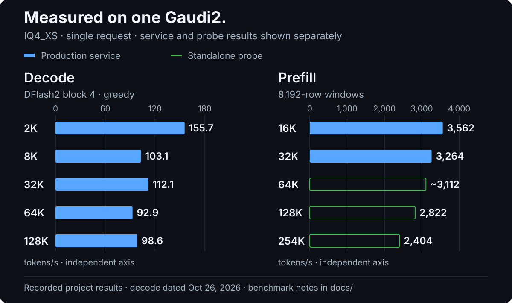

# Gaudi2 benchmark notes

[← README](../README.md#performance)

These numbers are preserved from this repository's README at revision `874502d`. They are recorded project measurements, not measurements performed during the README redesign. The repository does not attach raw per-request exports to that table.

## Recorded setup

- One Intel Gaudi2 HL-225, 98,304 MiB HBM.
- Qwen3.8-Flash-Next IQ4_XS GGUF, 512 experts, 48 layers.
- habanalabs / SynapseAI 1.24.1; `tpc-clang 2.7.33`.
- Ubuntu 24.04.4, g++ 13.3, CMake 4.4, Python 3.12.
- Xeon E5-2696 v3, 251 GB host RAM; approximately 28.8 GB used by PLE tables.
- One request at a time.

## Throughput

| Phase | Context / prompt label | Tokens/s | Measurement |
|:---|:---|---:|:---|
| Decode | 2K | 155.7 | Production service |
| Decode | 8K | 103.1 | Production service |
| Decode | 32K | 112.1 | Production service |
| Decode | 64K | 92.9 | Production service |
| Decode | 128K | 98.6 | Production service |
| Prefill | 16K | 3,562 | Production service |
| Prefill | 32K | 3,264 | Production service |
| Prefill | 64K | ~3,112 | Standalone probe |
| Prefill | 128K | 2,822 | Standalone probe |
| Prefill | 254K | 2,404 | Standalone probe |

Decode uses DFlash2, block size 4, greedy sampling, and the production service via [llm_speedtest](https://github.com/gengchaogit/llm_speedtest), dated October 26, 2026. The original record reports approximately 2.9 accepted tokens per verify round. It does not supply output lengths, repetitions, or error bars.

Prefill uses an 8,192-row window. The 16K and 32K results are from the production service; 64K and above are from a single-process probe. Long-context prefill uses sparse attention. The original table does not specify a prefill measurement date or a conversion for its K labels; those labels are retained verbatim.



## Separate timing observations

| Observation | Reported result | Conditions |
|:---|:---|:---|
| Four-row verification, before | 19.26 ms | 2K context |
| Four-row verification, after | 18.63 ms | `GDN_STEP_ROWS` and `GEMV_PARTS_GU_WINDOW`, enabled from October 27; trimmed mean of 119 windows |
| Decode without DFlash | ~12.8 ms/token | 2K context, standalone probe |

The verify-window change is approximately a 3.3% reduction in that timing. It is not a directly measured 3.3% increase in the October 26 service throughput, and it is not a measurement of end-to-end latency.

## Reading and updating the evidence

Keep production-service measurements separate from standalone probes. The configured context limit is 262,144 tokens; the 254K prefill probe does not validate every request type at the configured maximum. These numbers also use a different model, quantization, sampling policy, and execution path from the companion vLLM repository, so they are not a controlled engine comparison.

The editable source is [gaudi2-performance.csv](benchmarks/gaudi2-performance.csv). Its `approximate` field preserves the original `~3,112` notation. Regenerate the SVGs with Python's standard library:

```bash
python docs/assets/make_gaudi2_assets.py
```

For future measurements, record the revision, checkpoint files, sampling, context token counts, output length, warm-up state, repetitions, and whether the run uses the API or a standalone probe.
